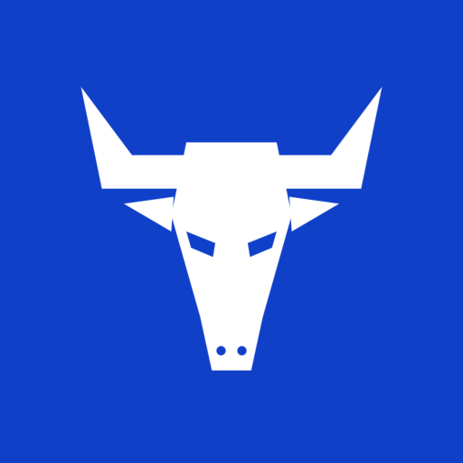

# OxisTrack

Made for the Teens Hack Houston (Triple H) Hackathon 2026, technical track.

Every project ends up with a pile of documents: the proposal, meeting notes, a spec, a spreadsheet.
They don't agree with each other. One says the deadline is March 3, another says March 10, and you
find out the hard way.

OxisTrack reads all of them for you. Upload your files and it:

- pulls out the facts and requirements
- flags where two documents disagree, and picks the most likely right answer
- checks your work against the requirements
- gives you a short to-do list of what to fix next

Less time re-reading docs, more time actually doing the work.

**Try it:** https://frontend-production-8cfd270e.up.railway.app
(click "Explore the sample project" on the sign-in page, no account needed)

## Run it yourself

You need Python 3.11+, Node 20+ and Docker.

```bash
docker compose up -d

cd backend
python -m venv .venv && source .venv/bin/activate
pip install -r requirements.txt
cp .env.example .env
alembic upgrade head
uvicorn app.main:app --port 8000
```

In a second terminal:

```bash
cd frontend
npm install
cp .env.local.example .env.local
npm run dev
```

Then open http://localhost:3000.

Built with Next.js, FastAPI and MySQL. More detail in [docs/DETAILS.md](docs/DETAILS.md).

Made by Yenula and Gagan.
